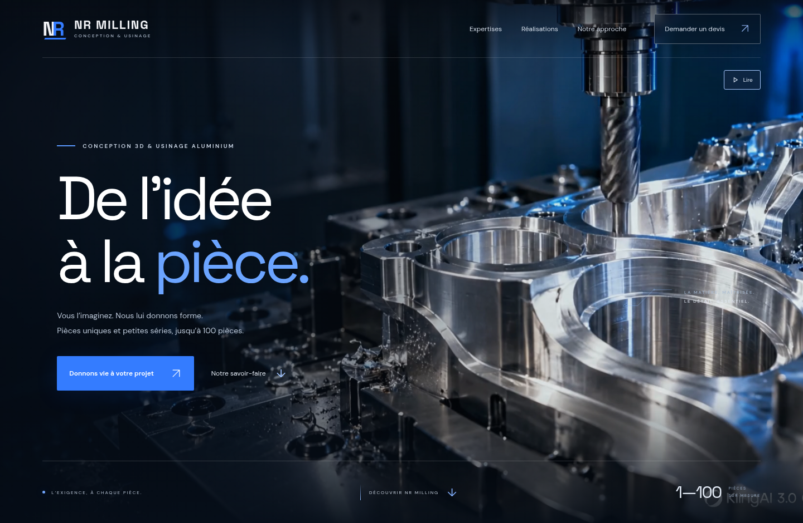
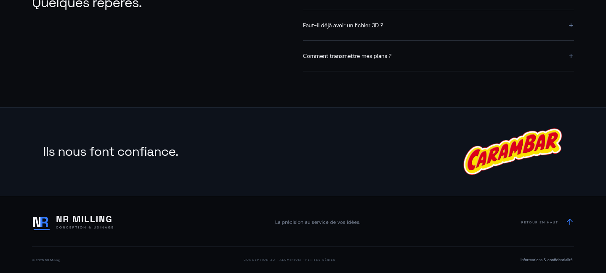
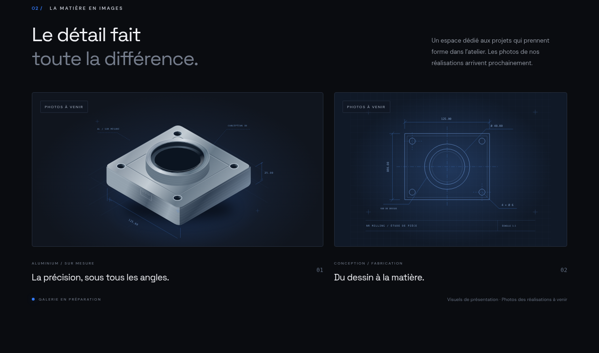
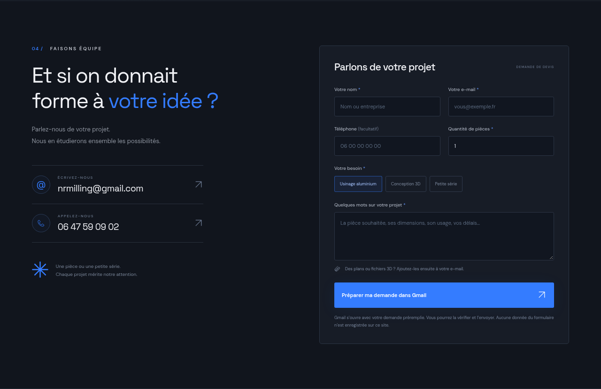

# NR Milling

Site vitrine en français, responsive, pour l’usinage aluminium, la conception 3D et les petites séries jusqu’à 100 pièces. Réalisé en HTML, JavaScript et CSS, sans dépendance, serveur applicatif ni base de données.

## Voir un aperçu sans télécharger

Les images ci-dessous sont des captures du site affiché dans un navigateur. Vous pouvez cliquer dessus sur GitHub pour les agrandir. Il s’agit de captures, pas d’une version interactive.

### Accueil



[Voir également l’accueil sur mobile](docs/apercu-mobile.png).

### Partenaires



La rubrique se trouve en bas du site, après les questions fréquentes. Elle affiche uniquement le titre « Ils nous font confiance » et une image du logo Carambar à côté, sans petite phrase ni nom recréé en typographie. Le logo est conservé dans `public/images/partenaires/carambar.png` et ses proportions sont préservées.

Source du fichier image existant (aucune génération ou recréation du logo) : [carambarLogo.png](https://github.com/Jordan-182/carambarFrontend/blob/060949fc1151a07f61369f0caaf783432e7b3b51/src/assets/carambarLogo.png). Ce fichier correspond à une version du logo Carambar avec contour blanc, différente de l’image à contour jaune jointe dans la conversation. Le fichier joint n’était pas accessible dans l’espace de travail ; pour employer exactement cette autre version, remplacer le PNG local par le fichier original, sans redessiner le logo.

### Galerie des réalisations



### Contact et devis



## Ouvrir le site simplement

Depuis GitHub : cliquer sur **Code → Download ZIP**, puis extraire entièrement l’archive et ouvrir `index.html` dans Chrome, Edge, Firefox ou Safari. Ne pas ouvrir le fichier directement à l’intérieur du ZIP ni avec l’application ChatGPT.

Ouvrir `index.html` dans un navigateur. Conserver les dossiers `src/` et `public/` à côté de ce fichier : ils contiennent les styles, le formulaire, les polices et les illustrations. Aucune installation n’est nécessaire pour consulter le site. Si vous utilisez une archive ZIP, l’extraire entièrement avant d’ouvrir le fichier HTML.

Le site fonctionne également sur un hébergement statique, à la racine d’un domaine ou dans un sous-dossier. Les ressources utilisent des chemins relatifs pour fonctionner dans ces différents cas.

## Développement

Pour le serveur de prévisualisation et la génération du dossier de publication : Node.js 18+ (validé avec Node.js 24). Aucune dépendance à installer.

```sh
cd /workspace/NRMilling
npm run dev
```

Le serveur local écoute sur le port 5173. Actualiser la page après une modification. Les tâches cloud disposent déjà d’un environnement isolé : utiliser le dépôt existant, sans créer de worktree.

```sh
npm run build
npm run preview
```

La version à déployer est le contenu complet du dossier `dist/`, compatible avec un hébergement statique. La commande de génération copie les fichiers sans les transformer et sans télécharger de dépendances. `npm run preview` sert ce dossier sur le port 4173.

## Demandes de devis

Le formulaire valide les champs puis ouvre un brouillon Gmail adressé à **nrmilling@gmail.com**, avec le nom, l’e-mail, le téléphone facultatif, la prestation, la quantité de 1 à 100 et la description du projet.

Le visiteur doit être connecté à Gmail, ajouter ses éventuelles pièces jointes puis envoyer le message lui-même. Un lien vers son application e-mail habituelle est également proposé. Le site ne transmet aucun e-mail automatiquement, ne stocke pas le formulaire et n’exige aucune clé API. Les coordonnées téléphoniques sont **06 47 59 09 02**.

## Ajouter vos photos

1. Créer le dossier `public/images/realisations/` et y placer des photos optimisées, idéalement en WebP ou JPEG, de moins de 500 Ko.
2. Modifier les entrées de `src/gallery.js` :

```js
window.NRMillingProjects = [
  {
    image: './public/images/realisations/support-aluminium.webp',
    title: 'Support aluminium sur mesure',
    category: 'USINAGE · PIÈCE UNITAIRE',
    alt: 'Support aluminium usiné, avec quatre perçages de fixation',
  },
];
```

3. Ajouter autant d’entrées que nécessaire, puis relancer `npm run build` pour mettre à jour le dossier de déploiement.

Les visuels initiaux sont des illustrations techniques originales, clairement identifiées comme visuels de présentation. Lorsque toutes les entrées disposent d’une photo, les textes « galerie en préparation » sont automatiquement remplacés par les textes de la galerie réelle. Prévoir un texte alternatif descriptif pour chaque photo.

## Image d’accueil

La première section affiche une image d’usinage en plein écran, avec une navigation superposée. L’image défile avec cette section et disparaît lorsqu’on descend vers les services. Le cadrage s’adapte au mobile. Les styles correspondants se trouvent dans `src/hero.css`.

Le visuel `public/images/hero-machining.webp` est une image de présentation générée, optimisée en WebP (environ 160 Ko), et ne représente pas l’atelier ou une réalisation réelle de NR Milling. Il peut être remplacé par une photographie de votre atelier en conservant ce chemin ; adapter si nécessaire les dimensions HTML et le cadrage dans `src/hero.css`.

## Avant publication

Compléter la fenêtre « Informations & confidentialité » dans `index.html` avec les véritables informations de l’entreprise : identité ou raison sociale de l’éditeur, statut, adresse professionnelle, immatriculation et hébergeur, selon les obligations applicables. Aucune identité ou adresse n’a été inventée.

Les polices sont hébergées localement dans `public/fonts/`, avec leurs licences OFL. Aucun outil de suivi ou cookie applicatif n’est installé. Un clic sur le formulaire ouvre un service externe (Gmail).
